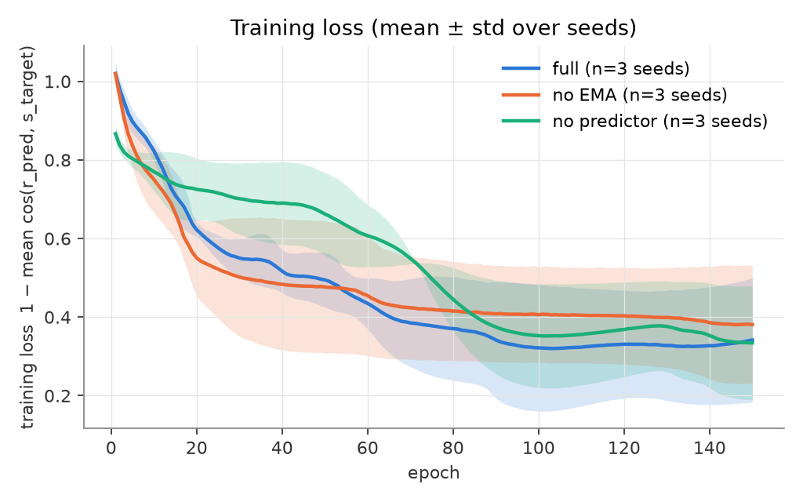

Code and data: <https://github.com/roquess/circuitjepa>

# Introduction

A Joint-Embedding Predictive Architecture (JEPA) learns representations by predicting the *embedding* of a target from the embedding of a context [@lecun2022path]. It never reconstructs the input and needs no negative pairs. Collapse is avoided by asymmetry: a predictor on the context branch and a target encoder that is an exponential moving average (EMA) of the context encoder and receives no gradient [@grill2020byol; @assran2023ijepa]. With an action-conditioned predictor, a JEPA becomes a latent world model [@lecun2022path; @assran2025vjepa2].

This paper asks a narrow feasibility question. Can this principle be implemented with parametrized quantum circuits throughout, on data that are themselves quantum states? And do the trained circuits keep their behaviour on a superconducting quantum processor? With quantum-native data, the encoder acts directly on the state produced by the (here, circuit-simulated) physical process, with no classical data loading.

The contribution is an implementation and a measured evaluation, not a performance result: (i) a JEPA whose encoder, EMA target encoder and action-conditioned predictor are all circuits, trained on spin-chain dynamics; (ii) ablations without EMA and stop-gradient, without predictor, and an untrained baseline, with collapse diagnostics and a dynamics probe; (iii) an evaluation of the same parameters on noiseless, noisy-simulated and real hardware, with a criterion fixed beforehand and further, exploratory hardware runs. All results are reported as measured, including those that did not go as expected.

# Related work

**JEPA and non-contrastive learning.** I-JEPA predicts EMA-encoder embeddings of masked image blocks with an L2 loss [@assran2023ijepa]; V-JEPA applies feature prediction to video [@bardes2024vjepa]; V-JEPA 2 adds an action-conditioned predictor used for planning [@assran2025vjepa2], the closest classical analogue of the predictor used here. Contrastive methods such as SimCLR need negative pairs [@chen2020simclr]. BYOL showed that a predictor plus an EMA target suffices without negatives, with a normalised (cosine) loss [@grill2020byol]; SimSiam showed that a stop-gradient alone can suffice, and that removing it leads to collapse [@chen2021simsiam]; VICReg uses explicit variance–covariance terms instead [@bardes2022vicreg]. I adopt the BYOL recipe (predictor, EMA target, cosine loss) because it needs neither negatives nor extra regularisers, which matters when every embedding costs measurements.

**Quantum machine learning.** CircuitJEPA is a variational quantum model [@cerezo2021variational; @biamonte2017quantum]. Lloyd et al. train quantum embeddings to separate classes, a supervised form of metric learning [@lloyd2020embeddings]. Jaderberg et al. introduce quantum self-supervised learning with small quantum networks inside a hybrid pipeline on classical images [@jaderberg2021quantum], and Edwards et al. insert a quantum module into SimCLR, MoCo v2 and BYOL backbones [@edwards2026width]. These works use classical data or classical backbones. Random deep circuits have barren plateaus [@mcclean2018barren], local costs on shallow circuits avoid them [@cerezo2021cost], and provable absence of barren plateaus often comes with classical simulability [@cerezo2025simulability]. The model here is small enough to be classically simulable, one reason why no advantage is claimed.

**Closest JEPA-like work.** Three recent works combine JEPA ideas with quantum ingredients. HQ-JEPA [@hossain2026hqjepa] is a classical JEPA for remote-sensing imagery with an added SWAP-test-based fidelity term; its encoders and predictor are classical. Quantum-JEPA [@liu2026quantumjepa] uses a quantum circuit as a Born-rule prior generating binary latent actions for an otherwise classical latent-action JEPA world model. QSWM [@jiang2026qswm] is quantum-*inspired*: a classical world model with density-matrix-like latents, evaluated on cellular automata. In CircuitJEPA the encoder, the EMA target encoder and the action-conditioned predictor are all parametrized circuits, the inputs are quantum states, and the embedding is a vector of Pauli expectations measured on a QPU. My search covered arXiv titles and abstracts and may miss very recent work; I did not find a prior architecture with these three components as circuits on quantum-native data, executed on hardware. That is the full extent of the novelty claim.

**Data and readout.** The data follow the standard Trotterized digital simulation [@lloyd1996universal]; circuits are built and run with Qiskit [@javadiabhari2024qiskit]. Embeddings are read out by Pauli-basis tomography; classical shadows [@huang2020shadows] are the scalable alternative.

# Method

**Data.** The data qubits form an open chain of $n = 3$ spins with $H = -J \sum_i Z_i Z_{i+1} - h \sum_i X_i$, $J = h = 1$, evolved by first-order Trotter steps $U_\delta = \prod_i e^{\,i h \delta X_i} \prod_{i} e^{\,i J \delta Z_i Z_{i+1}}$ ($R_{ZZ}$ and $R_X$ gates). Each sample starts from a product state with qubit $i$ in $R_Z(b_i) R_Y(a_i) \lvert 0 \rangle$, $a_i \sim \mathcal{U}[0, \pi]$, $b_i \sim \mathcal{U}[0, 2\pi]$. A sample is $(\psi_0, t_0, s)$ with $t_0 \in \{0, \dots, 3\}$ and $s \in \{1, 2, 3\}$ uniform; the context is $U_\delta^{t_0} \psi_0$ and the target $U_\delta^{t_0 + s} \psi_0$. The same circuits define the data in simulation and on hardware. I use 256 training samples (data seed 1234) and 64 test samples (data seed 5678), of which 18, 23 and 23 samples have $s = 1, 2, 3$.

**Encoder.** $E_\theta$ acts on the 3 data qubits plus 2 ancillas in $\lvert 0 \rangle$: 3 layers of $R_Y$, $R_Z$ on every qubit followed by a CZ chain, for 30 parameters in total. The latent is the reduced state of qubits 0 and 1; the other 3 qubits are traced out. The ancillas are there so that collapse is not excluded: with a single discarded qubit, a constant latent would be unreachable by a dimension argument, whereas with 3 discarded qubits that argument no longer excludes it. I did not check whether the ansatz can actually reach one.

**Predictor and target encoder.** $P_\phi$ is a 2-layer ansatz on the 2 latent qubits ($R_Y$, $R_Z$, then a CZ per layer; 8 parameters), applied $s$ times for time step $s$: the action is the number of steps. Its distance from the identity is $\lVert P - I \rVert := 1 - \lvert \mathrm{Tr}\, U_\phi \rvert / 4$. The target encoder $E_{\bar\theta}$ has the architecture of $E_\theta$, with $\bar\theta \leftarrow \tau \bar\theta + (1 - \tau)\theta$ after every step ($\tau = 0.99$) and no gradient.

**Embedding and loss.** The embedding of a latent state $\rho$ is its Bloch vector $r \in \mathbb{R}^{15}$, $r_P = \mathrm{Tr}(\rho P)$ over the non-identity two-qubit Paulis. The loss is $\mathcal{L} = 1 - \overline{\cos}(r_{\mathrm{pred}}, s_{\mathrm{target}})$ over the batch, with norms computed as $\sqrt{\lVert r \rVert^2 + \varepsilon^2}$, $\varepsilon = 10^{-8}$. I avoid the raw overlap $\mathrm{Tr}(\rho\sigma) = (1 + r \cdot s)/4$ because it depends on purity: it favours pure targets, and hardware noise would flatten it like collapse. The cosine is invariant to rescaling of either vector, in particular to global depolarisation, and is built from local observables rather than a global fidelity [@cerezo2021cost].

**Training and variants.** Training uses an exact statevector simulation in PyTorch (complex128) with automatic differentiation, Adam, and parameters initialised uniformly in $[0, 2\pi)$. Four variants are trained with seeds 0–9: **full**; **no_ema**, whose target branch shares $\theta$ and receives gradients, so both the EMA and the stop-gradient are removed; **no_predictor** ($P_\phi = I$); and **untrained** (random parameters).

# Experimental setup

**Configuration and tuning.** The final configuration is $\delta = 0.5$, $t_0 \le 3$, 3 encoder layers, 2 predictor layers, learning rate 0.02 (Adam), 150 epochs, $\tau = 0.99$, batch size 32, 256 training and 64 test samples. All values except $\delta$ are the original project defaults; $\delta = 0.5$ replaced the original default of 0.25 and is now also the code default. It was chosen on seeds 0–2 with a sanity gate fixed beforehand: mean `full` exact test top-1 at least 0.3 and no collapsed `full` seed, at most 4 attempts, same settings for all variants. Attempt 1 used the defaults ($\delta = 0.25$), trained all four variants and failed (`full` top-1 0.245 ± 0.157); `no_predictor` beat `full` there. Knowing this, I set attempts 2–4 together and ran them as one batch: $\tau = 0.996$ and 200 epochs (0.271 ± 0.212, fail), $\delta = 0.5$ (0.469 ± 0.402, pass), and learning rate 0.05 with batch size 16 (0.214 ± 0.140, fail). The rule was to keep a passing setting; only attempt 3 passed. The gate is defined on the test split (there is no validation split), so the `full` numbers carry a selection bias over four settings.

**Chronology.** Seeds 3–9 of all four variants were trained after a first version of these results had been committed, with the same final configuration; the gate and the configuration were not re-tuned.

**Metrics.** For $m$ test samples, $G_{ij} = \cos(r_{\mathrm{pred}, i}, s_{\mathrm{target}, j})$. *Top-1* is the fraction of rows with $\arg\max_j G_{ij} = i$ (chance $1/m$). The *diagonal gap* is the row mean of $g_i = G_{ii} - \mathrm{mean}_{j \ne i} G_{ij}$. A run is flagged *collapsed* when its gap is below 0.05 and its target total variance is below 5% of the same-seed untrained baseline. The *dynamics probe* is a ridge-regularised linear map (ridge $10^{-3}$) fitted on exact target embeddings (EMA encoder $E_{\bar\theta}$) of the training set to the true magnetisations $\langle Z_i \rangle(t_0+s)$. Its test MSE is reported for the *predicted* embedding and for the *un-advanced* context embedding ($E_\theta$ without predictor).

**Backends and readout.** The same parameters are evaluated on: **exact** (statevector, $m = 64$); **aer** (ideal Aer, 1000 shots, basis rz/sx/x/cz without connectivity constraints); **fake_fez** and **fake_marrakesh** (Aer with the device noise models of `qiskit-ibm-runtime` 0.52.1, 1000 shots); and **qpu** (`ibm_marrakesh` via the Sampler primitive with default options: no error mitigation, fractional gates not enabled; 1000, 500 or 450 shots depending on the submission). Shot-based backends use the first 16 test samples. For each sample the predicted, target and un-advanced circuits are measured in the 9 bases $\{X, Y, Z\}^{\otimes 2}$ of the latent qubits, and $G$ is computed classically. Circuits are transpiled at optimisation level 3 with a fixed seed. Software: Python 3.12.10, Qiskit 2.6.2, Qiskit Aer 0.18.2, qiskit-ibm-runtime 0.52.1, PyTorch 2.15.0.

**Pre-registered QPU criterion.** Before any training result was committed, I fixed the criterion in code (commit `a473602`; an internal pre-registration, not a public registry), with the seed-0 pair (`full` vs `untrained`) as the registered pair. The full model's per-row gaps must exceed the baseline's under a paired one-sided sign-flip test with 10,000 resamples at $p < 0.01$; the smallest attainable value is $1/10{,}001 \approx 1.0 \times 10^{-4}$. Its top-1 must exceed chance under a one-sided binomial test at $p < 0.05$. All other QPU runs are exploratory.

# Results

## Simulation

| variant | top-1 | diag. gap | total var. | mean $\lVert r\rVert$ | probe pred | probe unadv | $\lVert P-I\rVert$ |
|---|---|---|---|---|---|---|---|
| full | 0.539 ± 0.341 | 0.665 ± 0.186 | 1.552 ± 0.370 | 1.240 ± 0.177 | 0.0483 ± 0.0058 | 0.0715 ± 0.0258 | 0.461 ± 0.259 |
| no_ema | 0.369 ± 0.332 | 0.486 ± 0.286 | 1.288 ± 0.515 | 1.253 ± 0.118 | 0.0548 ± 0.0098 | 0.0691 ± 0.0236 | 0.639 ± 0.273 |
| no_predictor | 0.031 ± 0.040 | 0.116 ± 0.118 | 0.712 ± 0.344 | 1.189 ± 0.087 | 1.9033 ± 5.8633 | 1.9033 ± 5.8633 | 0.000 ± 0.000 |
| untrained | 0.008 ± 0.013 | -0.021 ± 0.047 | 1.366 ± 0.184 | 1.202 ± 0.061 | 0.0788 ± 0.0139 | 0.0815 ± 0.0189 | 0.836 ± 0.086 |

: Exact evaluation, $m = 64$, mean ± sample std over seeds 0–9 (chance top-1 1/64). No run was flagged as collapsed. The `no_predictor` probe values are dominated by one seed (Section 5.2).

{width=100%}

**Seed variance is large.** The `full` exact top-1 per seed is 59, 21, 10, 5, 28, 36, 50, 59, 15 and 62 out of 64 for seeds 0–9 (median 0.5), and the final training losses range from 0.105 to 0.532 (Figure 2). The seven seeds added later average 0.569 ± 0.341, against 0.469 ± 0.402 for the three tuning seeds. In exact simulation, every seed passes the tests of the pre-registered criterion (Section 4) against its own untrained baseline (sign-flip p = 1.0 × 10^-4^, the resampling floor, for each; binomial p between 3.3 × 10^-3^ for seed 3 and 2.0 × 10^-109^ for seed 9). `no_ema` is as dispersed: 20, 48, 7, 11, 31, 44, 12, 1, 61 and 1 out of 64.

{width=40%}

**The predictor is needed for retrieval.** Without it, top-1 retrieval is 0.031 ± 0.040 (chance 1/64 ≈ 0.016) and the diagonal gap is 0.116 ± 0.118, although the training loss ends in the same range as `full`. At $\delta = 0.25$ (attempt 1) the opposite held: `no_predictor` reached an exact top-1 of 0.500 ± 0.204, against 0.245 ± 0.157 for `full`, plausibly (untested) because a small step makes "target ≈ context" a competitive shortcut.

**Removing the EMA and stop-gradient did not cause flagged collapse.** `no_ema` reaches 0.369 ± 0.332 top-1 and 0.486 ± 0.286 diagonal gap, below `full` on average, and its target variance is 1.288 ± 0.515 (`full`: 1.552 ± 0.370). No `no_ema` run is flagged, but two seeds come close: seeds 7 and 9 retrieve 1 of 64 with gaps of 0.062 and 0.053 and target variances at 41% and 51% of their untrained baselines. The collapse SimSiam reports without stop-gradient [@chen2021simsiam] therefore did not occur in the flagged sense, but 2 of 10 `no_ema` seeds ended in a near-collapsed, non-retrieving state.

**Borderline cases.** `no_predictor` seed 2 has an exact diagonal gap of 0.0457, below 0.05; it is not flagged only because of the variance criterion (its target total variance is 0.720, against 1.158 for the untrained baseline). Its retrieval is 0/64, so I count it as near-collapsed, not healthy. Six other `no_predictor` seeds have gaps between 0.059 and 0.068 with at most 3 of 64 retrieved; `no_predictor` seed 0 (0/64, gap 0.068) has a uniformly high similarity matrix (Figure 4). Mean norms stay between 0.93 and 1.48 for all exact runs.

## Dynamics probe

{width=100%}

For `full` in exact simulation, the probe MSE is lower from the predicted embedding than from the un-advanced one (0.0483 ± 0.0058 against 0.0715 ± 0.0258), at every $s$ (0.0424, 0.0471, 0.0541 against 0.0566, 0.0831, 0.0716; Figure 3), and in 8 of 10 seeds. However, **the probe does not separate `full` from `no_predictor`**: over the 10 `no_predictor` seeds the median probe MSE is 0.0473, against 0.0480 for `full`. The probe is therefore at most weak evidence that the predictor advances the embedding in time. $\lVert P - I \rVert$ of 0.461 ± 0.259 shows that the learned predictor is not the identity. Retrieval itself may partly rely on conserved quantities (Section 6).

**Probe anomaly.** The `no_predictor` mean of 1.9033 ± 5.8633 comes from seed 5 alone, whose probe MSE is 18.5904; without seed 5 the mean is 0.0492 ± 0.0064 (I report this and the medians as robust statistics, alongside the unchanged probe). The cause is visible in that run's embeddings. Two Bloch components (XZ and YZ) are nearly constant across the 256 training targets (standard deviations 0.0072 and 0.0055), and the ridge probe gives them weights of up to 33.08. The predicted and un-advanced embeddings come from the online encoder $\theta$, while the training targets come from the EMA encoder $\bar\theta$, and the two differ enough to shift the means of these components by 0.082 and 0.151, so all 64 test samples have errors above 1. On seed 5's own target embeddings the probe's test MSE is 0.0295. The QPU value of `no_predictor` seed 0 (0.4694) is also large, with large probe weights on near-constant components.

**Probe differences on shot-based backends are within shot noise.** For `no_predictor`, the predicted and un-advanced circuits are identical, so their probe-MSE differences are pure sampling noise. Excluding seed 5, they reach 0.1035 on aer, 0.0905 on fake_fez and 0.0742 on fake_marrakesh (seed 5: 5.160, 3.888 and 4.767). The largest pred-versus-unadvanced difference of `full` on these backends is 0.0723, so I do not treat probe differences on shot-based backends, the QPU included, as significant.

## Noisy simulation

| backend | top-1 | diag. gap | total var. | mean $\lVert r\rVert$ |
|---|---|---|---|---|
| aer (noiseless, 1000 shots) | 0.656 ± 0.250 | 0.655 ± 0.169 | 1.483 ± 0.346 | 1.246 ± 0.173 |
| fake_fez | 0.681 ± 0.249 | 0.656 ± 0.169 | 1.224 ± 0.276 | 1.156 ± 0.155 |
| fake_marrakesh | 0.688 ± 0.238 | 0.656 ± 0.168 | 1.327 ± 0.303 | 1.191 ± 0.163 |

: `full` on the shot-based simulators ($m = 16$, chance 1/16), mean ± std over seeds 0–9.

Device noise changes top-1 and gap by less than the seed spread, while it shrinks the total variance and mean norm. The top-1 of the other variants barely moves: `no_ema` gives 0.494 ± 0.330, 0.481 ± 0.331 and 0.494 ± 0.330, and `untrained` gives 0.037 ± 0.044 on all three. A likely but undemonstrated explanation: the circuits are short (on average 19–27 CZ gates after transpilation for `ibm_marrakesh`, Section 5.4) and the cosine is purity-invariant, so a uniform contraction of the Bloch vectors changes $\lVert r \rVert$ but not $G$.

## QPU evaluation

**Runs.** All hardware runs took place on 2026-11-15 on `ibm_marrakesh` (IBM Heron), with $m = 16$ and 9 bases, i.e. 432 circuits per model, in four submissions:

1. the pre-registered pair (`ibm_marrakesh_20261115T100708+0000_6cc5cc3c`, 10:07 UTC, 1000 shots): `full` seed 0 as job `dbso8j9abdes73frdplg`, `untrained` seed 0 as job `dbso8jujjaos73aked3g`, each charged 118 s of QPU time;
2. `no_ema` seed 0, after the pair had completed (`ibm_marrakesh_20261115T101632+0000_a8e12a16`, 10:16 UTC, 1000 shots, job `dbsod0gk09pc73b0ebpg`, 118 s);
3. exploratory: `full` seeds 1 and 2 (`ibm_marrakesh_20261115T111035+0000_639c1344`, 11:10 UTC, 500 shots, jobs `dbsp6b8k09pc73b0fb80` and `dbsp6bok09pc73b0fb90`, 60 s each);
4. exploratory: `no_predictor` seed 0 and `untrained` seed 1 (`ibm_marrakesh_20261115T111502+0000_1fc85675`, 11:15 UTC, 450 shots, jobs `dbsp8e7v5hds73dj8png` and `dbsp8emjjaos73akfiog`, 55 s each).

Submissions 2–4 are not part of the pre-registered criterion; 3 and 4 were decided after the first results and use fewer shots to fit the remaining free-tier budget, of which 584 of 600 s were used in the end. `scripts/merge_qpu_eval.py` merges the raw counts of all seven runs, checking each run's parameter hash and shot count.

**Circuits and calibration.** For `full` seed 0, the transpiled circuits have a mean depth of 62.6 (maximum 84) and a mean of 21.4 two-qubit gates (maximum 27) for the predicted branch; for the target branch the mean depth is 77.8 (maximum 109) with a mean of 27.0 two-qubit gates (maximum 36); for the un-advanced branch, 48.2 (maximum 68) with a mean of 18.75 two-qubit gates (maximum 24). Only the first circuit's layout was recorded: [55, 54, 53, 39, 33] (latent qubits 55 and 54), the same for all seven runs. Layouts are chosen per circuit; re-transpiling the 432 `full` seed-0 circuits against `FakeMarrakesh` with the same settings, 404 used one layout and 28 another, and CZ was the only two-qubit gate. I saved a calibration snapshot at about 10:13 UTC (after the pair, before `no_ema`, about an hour before submissions 3 and 4). Its `last_update_date` is 2026-11-13 18:22:56+01:00, about 41 hours before the first job, and the quoted values carry dates between 54 and 57 hours before the first job, so they are context only. On the recorded layout it gives a median T1 of 176.4 µs, a median T2 of 184.1 µs, a median readout error of 0.0132 (0.0015 and 0.0039 on qubits 55 and 54), and the median CZ error on the four couplers of this chain is 0.00176.

| run | QPU shots | QPU top-1 | QPU gap | aer top-1 | aer gap | fake_marrakesh top-1 |
|---|---|---|---|---|---|---|
| full seed 0 (pre-reg.) | 1000 | 15/16 | 0.827 | 15/16 | 0.847 | 15/16 |
| untrained seed 0 (pre-reg.) | 1000 | 1/16 | 0.033 | 0/16 | 0.025 | 0/16 |
| no_ema seed 0 | 1000 | 7/16 | 0.455 | 7/16 | 0.453 | 7/16 |
| full seed 1 (expl.) | 500 | 10/16 | 0.428 | 8/16 | 0.431 | 8/16 |
| full seed 2 (expl.) | 500 | 6/16 | 0.512 | 6/16 | 0.554 | 8/16 |
| no_predictor seed 0 (expl.) | 450 | 2/16 | 0.151 | 1/16 | 0.148 | 1/16 |
| untrained seed 1 (expl.) | 450 | 1/16 | -0.021 | 1/16 | -0.027 | 1/16 |

: Every QPU run next to the same run on the shot-based simulators (same 16 samples, 1000 shots); chance 1/16.

**Pre-registered criterion: met.** The `full` seed-0 model retrieves 15 of 16 targets on the QPU, as on the simulators, against 1 of 16 for the untrained baseline. The diagonal-gap test gives p = 1.0 × 10^-4^ (the floor, below 0.01) and the binomial top-1 test gives p = 1.3 × 10^-17^ (below 0.05). By time step, top-1 is 1.000, 1.000 and 0.833 (5, 5 and 6 samples). Seed 0 was designated before any training result existed; it turned out to be the best of the three tuning seeds and, among the 10 seeds, ties for second (seed 9 reaches 62/64), so these numbers are not representative of the seed average. Relative to aer, the QPU leaves its top-1 unchanged and lowers the gap from 0.847 to 0.827, the total variance from 1.823 to 1.218 and the mean norm from 1.441 to 1.241, as with simulated noise.

**Exploratory QPU runs (not pre-registered).** `full` seeds 1 and 2 retrieve 10/16 and 6/16 on the QPU, against 8/16 and 6/16 on aer. Computed exactly like the pre-registered test, `full` seed 1 against `untrained` seed 1 gives sign-flip p = 5.0 × 10^-4^ and binomial p = 5.1 × 10^-9^. `untrained` seed 2 was not run on the QPU, so `full` seed 2 is compared with the seed-0 baseline on the same 16 samples (500 against 1000 shots): sign-flip p = 1.6 × 10^-3^ and binomial p = 2.8 × 10^-4^. Both would pass the thresholds, but they were not pre-registered, were chosen after the first QPU results, and use fewer shots. `no_predictor` seed 0 retrieves 2/16 on hardware (1/16 on aer) and `untrained` seed 1 retrieves 1/16. Across all seven runs, QPU top-1 is within two hits of the aer value.

{width=50%}

# Limitations

* **Scope.** 3 data qubits, 2 ancillas, a 2-qubit latent: classically simulable and trained entirely in simulation. Training with hardware gradients and shot noise was not tested. No advantage or scalability claim, and no comparison with a classical model.
* **Statistics.** Ten seeds (`full` top-1 ranges from 0.078 to 0.969); 16 samples on hardware (5 or 6 per $s$); three `full` seeds on hardware, two of them exploratory with 500 shots.
* **Selection.** The gate passed only at attempt 3 of 4 on seeds 0–2, is defined on test data, and $\delta$ was changed after attempt 1 had shown `no_predictor` beating `full` at $\delta = 0.25$. Conclusions are specific to this step size and carry a selection bias; seeds 3–9 were added later without re-tuning.
* **Seed on hardware.** The pre-registered QPU result is for seed 0, designated before training; it turned out to be the best of the three tuning seeds (tied second of ten). The other six QPU runs are exploratory and were added afterwards.
* **Collapse.** Removing EMA and stop-gradient did not cause flagged collapse, but 2 of 10 `no_ema` seeds and several `no_predictor` seeds are near-collapsed and non-retrieving; this setup does not show what prevents collapse.
* **Dynamics.** The probe does not separate `full` from `no_predictor`, can blow up when the online and EMA encoders differ on near-constant components, and on shot-based backends its differences are within sampling noise. Retrieval may partly rely on conserved quantities, such as the X-parity $\prod_i X_i$, which $U_\delta$ conserves exactly, or, approximately, the energy.
* **Noise.** The small effect of noise on top-1 and gap is measured (seven QPU runs, one per model); its explanation is a hypothesis. Calibration values are context only and refer to the first circuit's layout. No error mitigation was used.
* **Tomography cost.** A $k$-qubit latent needs $3^k$ bases and $4^k - 1$ expectation values, exponential in the latent size.

# Conclusion

I built CircuitJEPA, a JEPA implemented entirely with parametrized circuits: a quantum encoder with ancillas, an EMA target encoder, and an action-conditioned quantum predictor, trained with a Bloch-vector cosine loss in simulation on Trotterized transverse-field Ising dynamics. Executed on `ibm_marrakesh`, the pre-registered seed-0 model retrieved 15 of 16 targets and met the pre-registered criterion against an untrained baseline (sign-flip p = 1.0 × 10^-4^, the floor of 10,000 resamples; binomial p = 1.3 × 10^-17^); two further seeds, run exploratorily with fewer shots, retrieved 10/16 and 6/16. These results come with clear caveats. Retrieval varies strongly across ten seeds, removing the EMA and the stop-gradient did not cause flagged collapse, and the dynamics probe does not show that the predictor learns dynamics. Training was done only in simulation, at a scale that is classically simulable. Taken together, this is a feasibility demonstration at 5 qubits: the JEPA training principle can be expressed with circuits throughout, and on one QPU, top-1 stayed within two hits of the noiseless shot-based simulator for all seven runs, including three `full` seeds (two of them exploratory, with 500 shots). It is not evidence of quantum advantage, generality or scalability. The planned next steps are a short SPSA fine-tuning of the simulation-trained parameters on IBM hardware in a later free-tier usage period, and replacing tomography with classical shadows [@huang2020shadows]; I make no prediction about their outcome.

# References {-}

\small

::: {#refs}
:::
