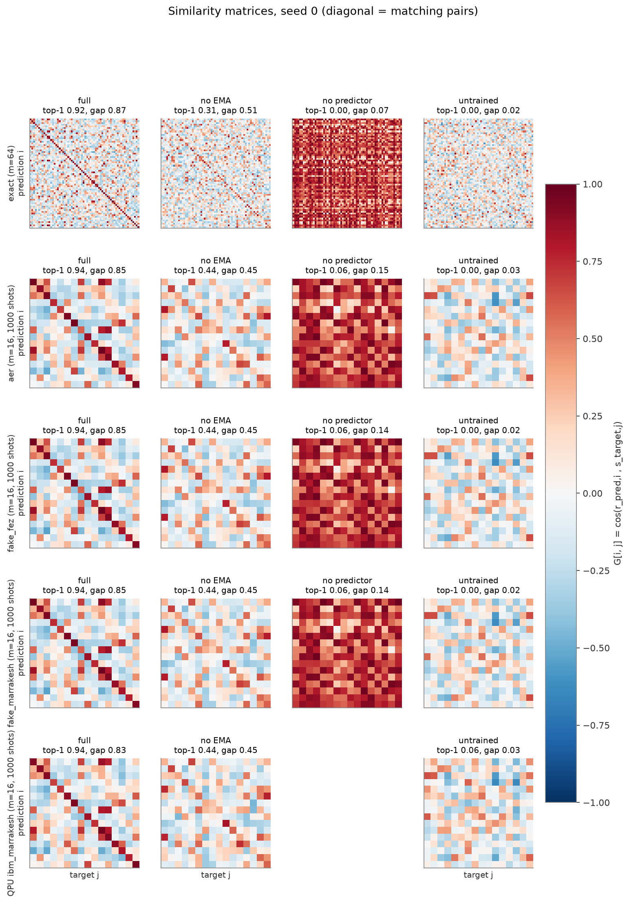

# Introduction

A Joint-Embedding Predictive Architecture (JEPA) learns representations by predicting the *embedding* of a target from the embedding of a context, and by pulling the two together in latent space [@lecun2022path]. Unlike generative models, it never reconstructs the input; unlike contrastive methods, it needs no negative pairs. Representation collapse is avoided with an asymmetric design: a predictor on the context branch and a target encoder that is an exponential moving average (EMA) of the context encoder and receives no gradient, as in BYOL [@grill2020byol] and I-JEPA [@assran2023ijepa]. When the predictor is conditioned on an action, the JEPA becomes a latent world model [@lecun2022path; @assran2025vjepa2].

This paper asks a narrow feasibility question: can this training principle be implemented with parametrized quantum circuits throughout, on data that are themselves quantum states, and do the trained circuits keep their behaviour when executed on a superconducting quantum processor? Quantum-native data are the natural setting for such a model. A quantum encoder then acts directly on the state produced by the physical process, with no classical-to-quantum data loading, and the latent dynamics to be learned are those of a quantum system.

CircuitJEPA consists of a quantum encoder that maps a 3-qubit state, together with 2 ancilla qubits, to a 2-qubit latent state; an EMA target encoder of the same architecture; and a quantum predictor acting on the latent register, applied $s$ times for a time step $s$. The embedding of a latent state is its vector of 15 two-qubit Pauli expectation values, and the loss is one minus the cosine similarity between predicted and target embeddings. We train it on the Trotterized dynamics of a transverse-field Ising chain and evaluate the trained circuits on simulators and on the IBM Heron device `ibm_marrakesh`.

Our contribution is an implementation and a measured evaluation, not a performance result. Specifically: (i) a JEPA in which encoder, EMA target encoder and action-conditioned predictor are all parametrized circuits, trained on quantum-native data; (ii) ablations without EMA, without predictor, and an untrained baseline, with collapse diagnostics and a dynamics probe; (iii) an evaluation of the same trained parameters on noiseless, noisy-simulated and real hardware, with a criterion fixed before the hardware run. We report all results as measured, including those that did not go as expected.

# Related work

**JEPA and latent world models.** LeCun's position paper proposes the JEPA as the building block of a hierarchical world model that predicts in representation space and is used for planning [@lecun2022path]. I-JEPA predicts the embeddings of masked image blocks produced by an EMA target encoder, without pixel reconstruction or hand-crafted augmentations [@assran2023ijepa]. V-JEPA applies feature prediction to video [@bardes2024vjepa], and V-JEPA 2 scales this approach and adds an action-conditioned predictor used for planning [@assran2025vjepa2]; it is the closest classical analogue of our predictor, which is conditioned on the number of time steps. MC-JEPA [@bardes2023mcjepa] and LeJEPA [@balestriero2025lejepa] are further variants, the latter replacing the EMA and stop-gradient heuristics by an explicit regulariser. Latent world models are also central to World Models [@ha2018world], Dreamer [@hafner2020dreamer; @hafner2023dreamerv3] and MuZero [@schrittwieser2020muzero], which learn their latent through reconstruction or reward signals rather than through pure latent prediction.

**Non-contrastive self-supervised learning and collapse.** Contrastive methods such as SimCLR rely on negative pairs to avoid trivial solutions [@chen2020simclr]. BYOL showed that a predictor plus an EMA target network suffices without negatives [@grill2020byol]; SimSiam showed that a stop-gradient alone can suffice [@chen2021simsiam]; DINO uses self-distillation with an EMA teacher [@caron2021dino]. Barlow Twins [@zbontar2021barlow] and VICReg [@bardes2022vicreg] prevent collapse with explicit redundancy-reduction or variance–covariance terms. Tian et al. analyse why predictor and stop-gradient/EMA dynamics avoid collapse in linear networks [@tian2021understanding], and Jing et al. study dimensional collapse, where embeddings occupy a low-dimensional subspace [@jing2022dimensional]. We adopt the BYOL/I-JEPA recipe (predictor, EMA target, cosine loss) because it needs neither negatives nor extra regularisers, which matters when every embedding costs measurements. We do not claim that the analysis of [@tian2021understanding] transfers to quantum circuits.

**Variational quantum models.** Variational quantum algorithms [@cerezo2021variational] and parametrized quantum circuits as machine-learning models [@benedetti2019parameterized] are the framework in which CircuitJEPA is built. Quantum feature maps embed classical data into Hilbert space [@schuld2019feature; @havlicek2019supervised], and supervised quantum models can be viewed as kernel methods [@schuld2021kernel]; see [@biamonte2017quantum] for a broad survey. CircuitJEPA differs from this supervised line in that it uses no labels: its learning signal is the consistency between predicted and target embeddings, and its inputs are quantum states rather than classical vectors.

**Quantum embeddings and quantum self-supervised learning.** Lloyd et al. train the embedding part of a circuit to separate classes, a supervised form of quantum metric learning [@lloyd2020embeddings]. Jaderberg et al. introduce quantum self-supervised learning with small quantum neural networks inside a hybrid pipeline for visual representations of classical images [@jaderberg2021quantum]. QSEA uses entanglement-based augmentation and a fidelity-driven loss [@li2025qsea]; Hou and Lu study quantum contrastive, metric and self-supervised learning beyond pairwise fidelity [@hou2026beyond]; Edwards et al. insert a quantum feature-extraction module into SimCLR, MoCo v2 and BYOL and compare these hybrids at matched width [@edwards2026width]. These works are contrastive or fidelity-based, or use classical data, or both.

**Prior JEPA-like quantum and quantum-inspired work.** Three recent works combine the JEPA idea with quantum ingredients, in ways that differ from ours. HQ-JEPA [@hossain2026hqjepa] is a hybrid model for remote-sensing imagery: its encoders and predictor are classical networks, and a quantum SWAP-test-based fidelity term is added to the loss. Quantum-JEPA [@liu2026quantumjepa] uses a quantum circuit as a conditional Born-rule prior that generates binary latent actions for an otherwise classical latent-action JEPA world model trained on robot demonstrations. QSWM [@jiang2026qswm] is a quantum-*inspired* world model: it runs on classical hardware with complex-valued, density-matrix-like latents and is evaluated on cellular automata. In CircuitJEPA, by contrast, the encoder, the EMA target encoder and the action-conditioned predictor are all parametrized quantum circuits, the inputs are quantum states, and the embedding is a vector of Pauli expectation values that we measured on a QPU. Our literature search covered arXiv titles and abstracts and may miss unindexed or very recent work. We did not find a prior architecture with all three components implemented as circuits on quantum-native data and executed on hardware. This is the full extent of our novelty claim.

**Trainability.** Random deep circuits suffer from barren plateaus, that is, exponentially vanishing gradients [@mcclean2018barren]; local cost functions on shallow circuits avoid them where global costs do not [@cerezo2021cost]; see [@larocca2025barren] for a review. Cerezo et al. argue that provable absence of barren plateaus often goes together with efficient classical simulability [@cerezo2025simulability]. Our circuits are shallow and act on 5 qubits, and the loss is built from one- and two-body Pauli expectations of a 2-qubit register. At this size the model is classically simulable, which is consistent with [@cerezo2025simulability] and is one reason why this work makes no advantage claim.

**Quantum data and learning quantum dynamics.** Learning from quantum experiments with quantum memory can be exponentially more sample-efficient than without it [@huang2022advantage], and classical shadows estimate many properties from few randomised measurements [@huang2020shadows]. Generalisation bounds from few training data [@caro2022generalization], out-of-distribution generalisation for learning quantum dynamics [@caro2023ood], and dynamical simulation via quantum machine learning with provable generalisation [@gibbs2024dynamical] are established for related settings. Quantum autoencoders compress quantum data through reconstruction [@romero2017autoencoder], and quantum convolutional neural networks classify phases of quantum states [@cong2019qcnn]. CircuitJEPA shares their quantum-native data setting but uses a predictive, non-reconstructive and label-free objective. Our data follow the standard digital-simulation construction by Trotterization [@lloyd1996universal]. The circuits are built and run with Qiskit [@javadiabhari2024qiskit]. We read embeddings out by Pauli-basis tomography; overlaps could instead be measured with a swap test [@buhrman2001fingerprinting; @garciaescartin2013swap], which we did not use.

# Method

## Data: a transverse-field Ising chain

The data qubits are an open chain of $n = 3$ spins with Hamiltonian
$$H = -J \sum_{i=1}^{2} Z_i Z_{i+1} - h \sum_{i=1}^{3} X_i, \qquad J = h = 1.$$
Dynamics are generated by a first-order Trotter step of size $\delta$,
$$U_\delta = \prod_{i} e^{\,i h \delta X_i} \prod_{\langle i, i+1 \rangle} e^{\,i J \delta Z_i Z_{i+1}},$$
implemented with $R_{ZZ}$ and $R_X$ gates. Each sample starts from a random product state, where qubit $i$ is prepared as $R_Z(b_i) R_Y(a_i) \lvert 0 \rangle$ with $a_i \sim \mathcal{U}[0, \pi]$ and $b_i \sim \mathcal{U}[0, 2\pi]$. A sample is a triple $(\psi_0, t_0, s)$, with offset $t_0 \in \{0, \dots, 3\}$ (so that contexts are not all product states) and time step $s \in \{1, 2, 3\}$, both uniform. The context is $U_\delta^{t_0} \psi_0$ and the target is $U_\delta^{t_0 + s} \psi_0$. Context and target are prepared by the same circuits in simulation and on hardware, so the data are identical by construction. We use 256 training samples (data seed 1234) and 64 test samples (data seed 5678); the 64 test samples contain 18, 23 and 23 samples with $s = 1, 2, 3$.

## Encoder and latent register

The encoder $E_\theta$ acts on the 3 data qubits plus 2 ancilla qubits initialised in $\lvert 0 \rangle$. It is a hardware-efficient ansatz of 3 layers; each layer applies $R_Y$ and $R_Z$ rotations to every qubit, followed by a chain of CZ gates between neighbouring qubits, for 30 parameters in total. The latent state is the reduced density matrix of $k = 2$ designated qubits (qubits 0 and 1); the other 3 qubits are traced out.

The ancillas exist so that collapse is reachable, and the collapse ablation is therefore meaningful. With only the 3 data qubits and a single discarded qubit, the discarded part could not absorb all the information of the input, and a constant latent state would be unreachable. With 3 discarded qubits, a constant latent is within reach of the ansatz family.

## Action-conditioned predictor

The predictor $P_\phi$ is a 2-layer ansatz on the 2 latent qubits ($R_Y$ and $R_Z$ on each qubit, then a CZ, per layer; 8 parameters). For time step $s$, it is applied $s$ times after the encoder: one learned latent step, rolled out $s$ times. The action is therefore the number of time steps. The predictor acts only on the latent qubits, so applying it before the partial trace is equivalent to applying the unitary to the reduced latent state. To measure how far the learned predictor is from the identity, we use $\lVert P - I \rVert := 1 - \lvert \mathrm{Tr}\, U_\phi \rvert / 4$, where $U_\phi$ is the $4 \times 4$ predictor unitary.

## Target encoder

The target encoder $E_{\bar\theta}$ has the architecture of $E_\theta$. Its parameters follow $\bar\theta \leftarrow \tau \bar\theta + (1 - \tau)\theta$ after every optimisation step, with $\tau = 0.99$, and receive no gradient. The context branch computes context $\to E_\theta \to P_\phi^{s} \to \rho_{\mathrm{pred}}$. The target branch computes target $\to E_{\bar\theta} \to \sigma_{\mathrm{target}}$.

## Embedding and loss

The embedding of a 2-qubit latent state $\rho$ is its generalised Bloch vector $r \in \mathbb{R}^{15}$, with components $r_P = \mathrm{Tr}(\rho P)$ for the 15 non-identity two-qubit Pauli operators $P$. For two latent states, $\mathrm{Tr}(\rho\sigma) = (1 + r \cdot s)/4$. The similarity is the cosine $\cos(r, s) = r \cdot s / (\lVert r \rVert \lVert s \rVert)$, with a small $\varepsilon = 10^{-8}$ added inside each norm so that a zero vector stays finite. The loss is
$$\mathcal{L} = 1 - \frac{1}{B} \sum_{b=1}^{B} \cos\!\left(r_{\mathrm{pred}, b},\, s_{\mathrm{target}, b}\right).$$
We do not use the raw overlap $\mathrm{Tr}(\rho\sigma)$ as a similarity because it depends on purity. It would favour the purest target over the right one, and hardware noise, which lowers purity, would flatten it in a way that resembles collapse. The cosine of the traceless parts is invariant to rescaling of either vector, and in particular to global depolarisation. The loss is built from one- and two-body observables of a shallow circuit and is not a global fidelity, in line with [@cerezo2021cost].

## Training and variants

Training uses an exact statevector simulation of the 5-qubit circuits, written in PyTorch with complex128 arithmetic; reduced latent density matrices and their Pauli vectors are computed from the statevector, and exact gradients are obtained by automatic differentiation. We use Adam with learning rate 0.02, batch size 32 and 150 epochs; all circuit parameters are initialised uniformly in $[0, 2\pi)$. We train four variants with model seeds 0, 1 and 2:

1. **full**: EMA target encoder and predictor;
2. **no_ema**: the target branch uses the same parameters $\theta$ as the context branch and receives gradients;
3. **no_predictor**: $P_\phi = I$;
4. **untrained**: random initial parameters, not trained, used as a baseline.

# Experimental setup

## Hyperparameters and tuning

The final configuration is $\delta = 0.5$, $t_0 \le 3$, 3 encoder layers, 2 predictor layers, learning rate 0.02 (Adam), 150 epochs, $\tau = 0.99$, batch size 32, 256 training and 64 test samples. All of these values except $\delta$ are the project defaults.

The configuration was chosen with a sanity gate that was fixed beforehand: the `full` exact test top-1 accuracy, averaged over the three seeds, must be at least 0.3 (chance is 1/64), and no `full` seed may be flagged as collapsed. Only training-level settings could change, identically for all variants, with at most 4 attempts. Attempt 1 used the defaults ($\delta = 0.25$) and failed (`full` top-1 0.245 ± 0.157). With attempt 1's numbers known, attempts 2–4 were set together and run as one batch: attempt 2 used $\tau = 0.996$ and 200 epochs (0.271 ± 0.212, fail), attempt 3 used $\delta = 0.5$ (0.469 ± 0.402, pass), and attempt 4 used learning rate 0.05 and batch size 16 (0.214 ± 0.140, fail). The selection rule, fixed before the batch was read, was to keep a setting that passes the gate. Attempt 3 was the only one that passed and was then re-run for all four variants. Attempts 2–4 were screened on `full` and `untrained` only, so the ablation results could not influence the choice. The gate is defined on the test split, and there is no separate validation split. The selection therefore used held-out test metrics, and the `full` numbers below carry a selection bias over four settings.

## Evaluation metrics

For $m$ test samples, we form the similarity matrix $G_{ij} = \cos(r_{\mathrm{pred}, i}, s_{\mathrm{target}, j})$.

* **Retrieval top-1 accuracy**: the fraction of rows $i$ with $\arg\max_j G_{ij} = i$ (chance $1/m$).
* **Diagonal gap**: the mean over rows of $g_i = G_{ii} - \frac{1}{m-1}\sum_{j \ne i} G_{ij}$.
* **Collapse diagnostics**: the total variance of the target embeddings across the test set, summed over the 15 components, and the mean norm $\lVert r \rVert$ of the predicted embeddings. A run is flagged **collapsed** when its diagonal gap is below 0.05 *and* its total variance is below 5% of that of the same-seed untrained baseline.
* **Dynamics probe**: this probe guards against an invariant shortcut, in which an encoder keeps only conserved quantities and the predictor stays close to the identity. We fit a ridge-regularised linear map (ridge $10^{-3}$, unpenalised bias) from the exact target-encoder embeddings of the 256 training samples to the per-site magnetisations $\langle Z_i \rangle$ of the true target state at time $t_0 + s$, which are not conserved. We then report its mean squared error (MSE) on the test set for the *predicted* embeddings and for the *un-advanced* context embeddings, that is, $E_\theta$ applied to the context without the predictor. The probe is always fitted on exact embeddings, including for shot-based backends.

## Backends

The same trained parameters are evaluated on five backends:

1. **exact**: noiseless statevector simulation, all $m = 64$ test samples;
2. **aer**: the ideal Qiskit Aer simulator with 1000 shots per circuit, after transpilation to a Heron-like basis (rz, sx, x, cz);
3. **fake_fez** and **fake_marrakesh**: Aer with the device noise models of the `FakeFez` and `FakeMarrakesh` backends of `qiskit-ibm-runtime` 0.52.1, 1000 shots;
4. **qpu**: the IBM Heron processor `ibm_marrakesh` through Qiskit Runtime (Sampler primitive with default options; no error-mitigation options were set), 1000 shots.

The shot-based backends use the first $m = 16$ test samples. Embeddings are obtained by Pauli-basis tomography of the 2 latent qubits. For each sample, the predicted (context), target and un-advanced circuits are each measured in the 9 product bases $\{X, Y, Z\}^{\otimes 2}$, so each model requires $3 \times 16 \times 9 = 432$ circuits. The 15 expectation values are estimated from the counts, and $G$ is computed classically. Circuits are transpiled at optimisation level 3 with a fixed transpiler seed. Software versions: Python 3.12.10, Qiskit 2.6.2, Qiskit Aer 0.18.2, qiskit-ibm-runtime 0.52.1, PyTorch 2.15.0.

## Pre-registered QPU criterion

Before the hardware run, we fixed the following criterion, with the seed-0 pair (`full` vs `untrained`) as the registered pair. The full model's diagonal gap must exceed that of the untrained baseline, tested with a paired one-sided sign-flip test on the per-row gaps $g_i^{\mathrm{full}} - g_i^{\mathrm{untrained}}$ with 10,000 random sign flips, at $p < 0.01$. In addition, its top-1 accuracy must exceed chance, tested with a one-sided binomial test against $1/m$, at $p < 0.05$. With 10,000 resamples, the smallest attainable sign-flip p-value is $1/10{,}001 \approx 1.0 \times 10^{-4}$. Seed 0 turned out to be the best of the three seeds in simulation; we come back to this in Section 5.5.

# Results

## Simulation ablations

Table 1 summarises the exact evaluation over the three seeds, and Figure 1 shows the ablations on all backends.

| variant | top-1 | diag. gap | total var. | mean $\lVert r\rVert$ | probe pred | probe unadv | $\lVert P-I\rVert$ |
|---|---|---|---|---|---|---|---|
| full | 0.469 ± 0.402 | 0.632 ± 0.210 | 1.562 ± 0.479 | 1.249 ± 0.232 | 0.0498 ± 0.0082 | 0.0830 ± 0.0289 | 0.453 ± 0.330 |
| no_ema | 0.391 ± 0.327 | 0.573 ± 0.219 | 1.527 ± 0.522 | 1.293 ± 0.201 | 0.0544 ± 0.0086 | 0.0838 ± 0.0372 | 0.523 ± 0.255 |
| no_predictor | 0.031 ± 0.054 | 0.175 ± 0.204 | 0.839 ± 0.138 | 1.123 ± 0.146 | 0.0474 ± 0.0012 | 0.0474 ± 0.0012 | 0.000 ± 0.000 |
| untrained | 0.000 ± 0.000 | -0.030 ± 0.051 | 1.279 ± 0.161 | 1.176 ± 0.074 | 0.0803 ± 0.0059 | 0.0918 ± 0.0118 | 0.894 ± 0.095 |

: Exact (noiseless) evaluation on $m = 64$ test samples, mean ± sample standard deviation over seeds 0, 1, 2. Chance top-1 is 1/64. No run was flagged as collapsed.

{width=100%}

**Seed variance is large.** The `full` exact top-1 is 59/64 (0.922) for seed 0, 21/64 (0.328) for seed 1 and 10/64 (0.156) for seed 2, so the mean of 0.469 is dominated by one seed. The corresponding diagonal gaps are 0.872, 0.536 and 0.486, and the final training losses are 0.117, 0.442 and 0.466 (Figure 2). All three `full` seeds pass the pre-registered tests against their same-seed untrained baseline in exact simulation (sign-flip p = 1.0 × 10^-4^ for each; binomial p = 1.9 × 10^-100^, 2.5 × 10^-22^ and 6.1 × 10^-8^). `no_ema` shows similar dispersion, with top-1 of 20/64, 48/64 and 7/64 for seeds 0–2. Its seed 1 is better than `full` seed 1, while its seed 0 is much worse than `full` seed 0.

{width=80%}

**The predictor is needed for retrieval.** Without the predictor, top-1 retrieval is 0.031 ± 0.054, which is near chance (1/64 ≈ 0.016), and the diagonal gap is 0.175 ± 0.204. Its training loss nevertheless ends in the same range as that of `full` (Figure 2). With $\delta = 0.5$, the context embedding alone does not identify the state reached $s$ steps later. This was not the case at $\delta = 0.25$ (attempt 1): there, `no_predictor` reached an exact top-1 of 0.500 ± 0.204, against 0.245 ± 0.157 for `full`, because a single small Trotter step changes the state little and "target ≈ context" was a competitive shortcut.

**Removing the EMA did not cause collapse.** `no_ema` reaches 0.391 ± 0.327 top-1 and 0.573 ± 0.219 diagonal gap, close to `full`. Its target-embedding variance (1.527 ± 0.522) does not shrink compared with `full` (1.562 ± 0.479). The collapse expected from the classical literature when the EMA is removed did not materialise in this setup.

## Collapse diagnostics

No run, of any variant and on any backend, was flagged as collapsed. One case is close to the threshold. `no_predictor` seed 2 has an exact diagonal gap of 0.0457, below the 0.05 threshold. It is not flagged only because of the variance criterion: its target total variance is 0.720, against 1.158 for the untrained seed-2 baseline, far above the 5% threshold. Its retrieval is 0/64. Under a gap-only criterion it would count as collapsed; we report it as a near-collapsed, non-retrieving model rather than as a healthy one. The mean embedding norms stay between 0.95 and 1.48 for all exact runs, so no run approaches the maximally mixed latent ($\lVert r \rVert = 0$).

## Dynamics probe

{width=100%}

In exact simulation, the probe MSE from the predicted embedding of `full` is lower than from the un-advanced embedding (0.0498 ± 0.0082 against 0.0830 ± 0.0289), and lower at every $s$ (0.0425, 0.0470, 0.0582 against 0.0614, 0.0992, 0.0838 for $s = 1, 2, 3$). The un-advanced error does not grow monotonically with $s$. Per seed, the separation is clear for seeds 0 and 1 (0.0414 against 0.0936, and 0.0579 against 0.1052) but absent for seed 2 (0.0500 against 0.0504).

The probe does not separate `no_predictor` from `full`. The `no_predictor` model, whose retrieval is near chance, has a probe MSE of 0.0474 ± 0.0012, lower than that of the `full` predicted embedding. Its predicted and un-advanced embeddings coincide by construction. The magnetisation of the target state is thus about as linearly decodable from a model that does not predict as from one that does. We therefore treat the probe as weak evidence that the predictor learns dynamics. The stronger evidence is the retrieval gap between `full` and `no_predictor`. A distance $\lVert P - I \rVert$ of 0.453 ± 0.330 for `full` confirms that the learned predictor is not the identity.

**Probe differences on shot-based backends are within shot noise.** For `no_predictor`, the predicted and un-advanced circuits are identical, so any difference between their probe MSEs comes only from sampling. These differences reach 0.0519 on aer, 0.0905 on fake_fez and 0.0742 on fake_marrakesh (all for seed 0). The pred-versus-unadvanced differences of `full` on these backends (for example 0.0475 on aer for seed 0) are of the same magnitude or smaller. We therefore do not treat probe-MSE differences of this size on shot-based backends, including the QPU, as significant.

## Noisy simulation

Table 2 compares the shot-based backends for the `full` model, averaged over seeds.

| backend | top-1 | diag. gap | total var. | mean $\lVert r\rVert$ |
|---|---|---|---|---|
| aer (noiseless, 1000 shots) | 0.604 ± 0.295 | 0.611 ± 0.214 | 1.467 ± 0.453 | 1.269 ± 0.219 |
| fake_fez | 0.625 ± 0.272 | 0.612 ± 0.213 | 1.216 ± 0.362 | 1.178 ± 0.200 |
| fake_marrakesh | 0.646 ± 0.253 | 0.614 ± 0.212 | 1.314 ± 0.398 | 1.214 ± 0.208 |

: `full` model on the shot-based simulators ($m = 16$, chance 1/16), mean ± std over three seeds.

The device noise models leave the retrieval metrics almost unchanged relative to the noiseless shot-based simulator. The top-1 and gap differences between rows are smaller than the seed-to-seed spread, and for seed 0 the top-1 is 15/16 on all three. The noise does shrink the embeddings: the total variance and the mean norm decrease. A likely explanation, which we have not demonstrated, has two parts. The circuits are shallow (Section 5.5). And the cosine similarity is purity-invariant by construction, so a uniform contraction of the Bloch vectors changes $\lVert r \rVert$ but not $G$. The same pattern holds for the other variants: `no_ema` gives 0.521 ± 0.321 top-1 on all three simulators, and `untrained` gives 0.021 ± 0.036.

## QPU evaluation on ibm_marrakesh

**Protocol and resources.** The hardware runs took place on 2026-11-15 on `ibm_marrakesh`, an IBM Heron processor. We evaluated $m = 16$ test samples, 9 Pauli bases and 1000 shots, which gives 432 circuits per model. The pre-registered pair was submitted first (submission `ibm_marrakesh_20261115T100708+0000_6cc5cc3c`, 10:07 UTC): `full` seed 0 as job `dbso8j9abdes73frdplg` and `untrained` seed 0 as job `dbso8jujjaos73aked3g`. The `no_ema` seed-0 model was a second submission, made after the pre-registered pair had completed (submission `ibm_marrakesh_20261115T101632+0000_a8e12a16`, 10:16 UTC, job `dbsod0gk09pc73b0ebpg`). It is not part of the pre-registered criterion. Because the evaluation command processes one submission at a time, `scripts/merge_qpu_eval.py` merges the saved raw counts of both submissions into a single evaluation. It checks each run's parameter hash against the hash stored at submission time. Each of the three jobs was charged 118 s of QPU time.

**Circuits.** The recorded layout (that of the first transpiled circuit of each branch, identical for all three models) maps logical qubits 0–4 to the physical qubits [55, 54, 53, 39, 33], so the latent qubits are 55 and 54. For the `full` model, the transpiled circuits have a mean depth of 62.6 (maximum 84) and a mean of 21.4 two-qubit gates (maximum 27) for the predicted branch. For the target branch, the mean depth is 77.8 (maximum 109) with a mean of 27.0 two-qubit gates (maximum 36); for the un-advanced branch, 48.2 (maximum 68) with a mean of 18.75 two-qubit gates (maximum 24). The calibration snapshot we stored for the device carries the timestamp `last_update_date` 2026-11-13 18:22:56+01:00, about 41 hours before the first job, so it is given only as context. For the five physical qubits used, it gives a median T1 of 176.4 µs, a median T2 of 184.1 µs and a median readout error of 0.0132 (0.0015 and 0.0039 on the two measured latent qubits). The median CZ error on the four couplers of the chain is 0.00176.

| model (seed 0) | top-1 | diag. gap | total var. | mean $\lVert r\rVert$ |
|---|---|---|---|---|
| full, aer | 0.938 | 0.847 | 1.823 | 1.441 |
| full, fake_marrakesh | 0.938 | 0.847 | 1.634 | 1.378 |
| full, ibm_marrakesh | 0.938 | 0.827 | 1.218 | 1.241 |
| no_ema, ibm_marrakesh | 0.438 | 0.455 | 1.246 | 1.160 |
| untrained, ibm_marrakesh | 0.062 | 0.033 | 0.947 | 1.076 |

: Seed-0 models on the QPU, with the `full` model on two simulators for comparison ($m = 16$, chance 1/16).

**Pre-registered criterion.** The `full` seed-0 model retrieves 15 of 16 targets on the QPU, as on the simulators, against 1 of 16 for the untrained baseline. The diagonal-gap test gives p = 1.0 × 10^-4^, the smallest attainable value with 10,000 resamples, which is below 0.01. The binomial top-1 test gives p = 1.3 × 10^-17^, below 0.05. The criterion is met. By time step, the QPU top-1 of `full` is 1.000, 1.000 and 0.833 for $s = 1, 2, 3$ (5, 5 and 6 samples). The `no_ema` seed-0 model gives 0.438 top-1 (7/16) on the QPU, in line with its simulated value (also 7/16 on all three shot-based simulators).

Seed 0 is the best of the three `full` seeds. It was designated as the hardware pair before the QPU run, but the hardware numbers in Table 3 should be read as those of the best seed, not as representative of the seed average (Table 2). Compared with the noiseless shot-based simulator, the QPU leaves top-1 unchanged, lowers the diagonal gap from 0.847 to 0.827, and lowers the total variance from 1.823 to 1.218 and the mean norm from 1.441 to 1.241. This is the same pattern as with the simulated device noise, and the same tentative explanation applies. Figure 4 shows the similarity matrices.

{width=88%}

# Limitations

* **No advantage, no scalability claim.** The model has 3 data qubits, 2 ancillas and a 2-qubit latent. It is classically simulable, and we trained it by classical simulation. Nothing here shows a benefit over a classical model, and we did not compare against one.
* **Training entirely in simulation.** All parameters were trained in exact simulation; the hardware was used only for evaluation. We have not tested whether the training procedure works with hardware gradients, shot noise and device drift.
* **Seed variance and few seeds.** With three seeds, top-1 ranges from 0.156 to 0.922 for `full`; a mean ± std over three values is a coarse summary.
* **Selection on test metrics.** The sanity gate passed only at attempt 3 of 4 (changing $\delta$ from 0.25 to 0.5), and the gate is defined on the test split. The reported `full` numbers therefore carry a selection bias. At $\delta = 0.25$ the no-predictor shortcut outperformed the full model, so the conclusions above are specific to the chosen step size.
* **Best seed on hardware.** The QPU result is for seed 0, the best seed. It was designated before the hardware run but is not representative of the seed average. The `no_ema` QPU run was added after the pre-registered pair.
* **Expected collapse not reproduced.** Removing the EMA did not lead to collapse. This setup therefore does not show that the EMA is what prevents collapse. One near-collapsed run (`no_predictor` seed 2) escaped the collapse flag only through the variance criterion.
* **Weak dynamics evidence.** The linear probe does not separate the `no_predictor` model from `full`, and on shot-based backends its differences are within shot noise. The evidence that the predictor captures dynamics comes mainly from retrieval.
* **Invariant shortcut.** Retrieval among 16 or 64 random samples can partly rely on sample-specific quantities that the evolution preserves, such as energy. The probe was meant to rule this out, and as noted above it does so only weakly.
* **Noise robustness is not explained.** The insensitivity to device noise is measured; its explanation (shallow circuits, purity-invariant cosine) is a hypothesis. The calibration data we stored predate the runs by about 41 hours. No error mitigation was used.
* **Tomography cost.** Reading out a $k$-qubit latent embedding by Pauli-basis tomography requires $3^k$ measurement bases and $4^k - 1$ expectation values, which grows exponentially with the latent size. The protocol used here is only practical for very small latents.
* **Small evaluation sets.** Hardware and shot-based results use 16 test samples; per-$s$ figures rest on 5 or 6 samples.

# Next steps

The following work is planned; we make no prediction about its outcome.

* A short fine-tuning of the simulation-trained parameters directly on IBM hardware, with a gradient-free optimiser (SPSA), within the free-tier QPU budget.
* Experiments on larger spin systems and latent registers.
* Replacing Pauli-basis tomography with classical shadows [@huang2020shadows] for reading out the latent embeddings.

# References {-}

::: {#refs}
:::
